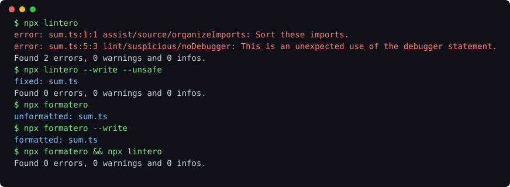

# aljazmc

[](https://github.com/aljazmc/aljazmc/actions/workflows/ci.yml)
[](LICENSE)
[](https://www.npmjs.com/~aljazmc)
[](https://www.typescriptlang.org/)
[](https://esbuild.github.io/)
[](https://yarnpkg.com/)
[](#development)
[](https://www.conventionalcommits.org/)

Lightweight npm packages written in modern TypeScript: a formatter, a
linter, a monorepo release tool and a test runner. They depend on nothing
outside this repository, except esbuild for testero, and are published by
[aljazmc on npm](https://www.npmjs.com/~aljazmc).

<p align="center">
  
</p>

## Features

- **Four tools, no dependencies.** A formatter, a linter, a test runner and
  a release tool that depend on nothing outside this repository, except
  esbuild for testero.
- **Eight languages.** formatero formats CSS, HTML, JavaScript, JSON, JSX,
  Markdown, TypeScript and YAML; lintero lints all of them but YAML with
  287 rules, fixes and sorted imports.
- **One parser.** Every tool shares `@aljazmc/syntax`, bundled in by
  esbuild.
- **Checked by itself.** formatero formats this repository, lintero lints
  it and testero runs its tests.
- **Released by CI.** After every passing push to `main`, CI versions,
  publishes, tags and releases on GitHub each package that changed, from
  its conventional commits, without committing anything.

## Quick start

```sh
npm install --save-dev @aljazmc/formatero @aljazmc/lintero
npx formatero            # lists unformatted files
npx formatero --write    # formats them in place
```

The packages need Node.js 22.18+, 24.2+, 25 or 26; each package's README
lists its commands and options.

To work on the packages, clone the repository and let Docker do the rest:

```sh
git clone https://github.com/aljazmc/aljazmc.git
cd aljazmc
./project.sh start
```

## Packages

| Package                         | Description                                                                 | Version                                      |
| ------------------------------- | --------------------------------------------------------------------------- | -------------------------------------------- |
| [formatero](packages/formatero) | Formats CSS, HTML, JavaScript, JSON, JSX, Markdown, TypeScript and YAML.    | [![version][formatero-badge]][formatero-npm] |
| [lintero](packages/lintero)     | Lints the same languages but YAML with 287 rules, fixes and sorted imports. | [![version][lintero-badge]][lintero-npm]     |
| [monorepo](packages/monorepo)   | Versions packages by conventional commits, fixes rebased tags.              | [![version][monorepo-badge]][monorepo-npm]   |
| [testero](packages/testero)     | Runs Jest-like tests in JavaScript, JSX and TypeScript.                     | [![version][testero-badge]][testero-npm]     |

[formatero-badge]: https://img.shields.io/npm/v/@aljazmc/formatero?label=&color=cb3837
[formatero-npm]: https://www.npmjs.com/package/@aljazmc/formatero
[lintero-badge]: https://img.shields.io/npm/v/@aljazmc/lintero?label=&color=cb3837
[lintero-npm]: https://www.npmjs.com/package/@aljazmc/lintero
[monorepo-badge]: https://img.shields.io/npm/v/@aljazmc/monorepo?label=&color=cb3837
[monorepo-npm]: https://www.npmjs.com/package/@aljazmc/monorepo
[testero-badge]: https://img.shields.io/npm/v/@aljazmc/testero?label=&color=cb3837
[testero-npm]: https://www.npmjs.com/package/@aljazmc/testero

## Shared code

Bundled into the packages by esbuild, and published for their types.

| Package                          | Description                                                             |
| -------------------------------- | ----------------------------------------------------------------------- |
| [@aljazmc/config](shared/config) | Loads `<package>.config.ts` files, finds files and matches globs.       |
| [@aljazmc/syntax](shared/syntax) | Parses CSS, HTML, JavaScript, JSON, JSX, Markdown, TypeScript and YAML. |

## Development

Requires only Docker with Compose, everything else runs in a container.

The repository checks itself with its own packages: formatero formats it,
lintero lints it and organizes its imports, and testero runs its tests.
Scripts build the package they run first, so they also work in a fresh
clone.

| Command                                                         | Description                                              |
| --------------------------------------------------------------- | -------------------------------------------------------- |
| `./project.sh clean`                                            | Removes the container, dependencies and generated files. |
| `./project.sh start`                                            | Installs dependencies, then lints, tests and builds all. |
| `docker compose run --rm node yarn <script>`                    | Runs any script of `package.json`.                       |
| `docker compose run --rm node node packages/<name>/bin/main.js` | Runs a package on this repository.                       |

### Scripts

Scripts are named `<prefix>:<package>`, like `c:lintero`, and most
prefixes also have `<prefix>:all`.

| Prefix   | Description                                 |
| -------- | ------------------------------------------- |
| `b:`     | Builds the package with esbuild.            |
| `c:`     | Lints, tests, builds and exports the types. |
| `ct:`    | Checks the types.                           |
| `et:`    | Exports the types as declaration files.     |
| `l:`     | Checks the formatting and lints.            |
| `lw:`    | Writes the safe fixes and the formatting.   |
| `lwu:`   | Writes the unsafe fixes too.                |
| `p:`     | Publishes to npm.                           |
| `t:`     | Runs the tests.                             |
| `te2e:`  | Runs the end-to-end tests.                  |
| `tunit:` | Runs the unit tests.                        |

| Script             | Description                                            |
| ------------------ | ------------------------------------------------------ |
| `record:formatero` | Records what Biome 2.6.6 prints for formatero's cases. |
| `record:lintero`   | Records what Biome 2.6.6 reports for lintero's cases.  |
| `c:github`         | Lints and tests the scripts of CI and the picture.     |
| `t:coverage`       | Runs all tests and reports the coverage.               |
| `test:w`           | Runs all tests again whenever a file changes.          |
| `typecheck:w`      | Checks the types again whenever a file changes.        |

### CI/CD

```
push to main, ci.yml
├─> yarn c:<package>   checks each changed package, and the release script
├─> coverage           all tests, with the coverage in the job summary
└─> quickstart         the quick start above, with the packages from npm

a passing ci.yml on main, release.yml
├─> release.ts plan    the versions due, from conventional commits since each tag
├─> yarn c:<package>   checks each with its version written in
├─> npm publish        publishes it, a dependency before what uses it
├─> git tag            tags it @aljazmc/<name>@<version> and pushes the tag
└─> gh release         a GitHub release with notes from its commits
```

Versions live in the tags only: `package.json` keeps `0.0.0-development`,
and no version is ever committed. `feat` releases a minor version; `fix`,
`perf`, `docs`, `chore` and `revert` a patch; a breaking change a major one,
before 1.0.0 a minor one; `style`, `test`, `build` and `ci` nothing. A
commit counts for each package whose folder, or bundled `shared/` code, it
changes. Every Monday CI checks everything again and opens an issue when
that fails.

### Layout

| Path                  | Description                                                |
| --------------------- | ---------------------------------------------------------- |
| `<package>.config.ts` | How the packages check this repository.                    |
| `.github/scripts/`    | The release script, and the one that draws the picture.    |
| `packages/<name>/`    | Published packages, each with `src/`, `tests/` and README. |
| `project.sh`          | Creates the container and runs the checks.                 |
| `shared/<name>/`      | Code bundled into the packages.                            |

## Troubleshooting

| What you see                                                                  | Why                                                                                                                                   | What to do                                                                            |
| ----------------------------------------------------------------------------- | ------------------------------------------------------------------------------------------------------------------------------------- | ------------------------------------------------------------------------------------- |
| `npx formatero` or `npx lintero` prints nothing and exits with 0              | Node.js is older than the packages need, like 22.12; npm warned `EBADENGINE` when installing them                                     | Check `node -v`, then update to Node.js 22.18+, 24.2+, 25 or 26                       |
| `npx formatero` prints `Hello, formatter!`, or `npx lintero` `Hello, linter!` | On a Node.js the packages do not list, like 27, npm installs the newest version that allows it, the placeholders of March             | Use Node.js 22.18+, 24.2+, 25 or 26, then install again                               |
| `unformatted: <file>` and exit code 1                                         | The file is not formatted yet; that is what checking reports                                                                          | `npx formatero --write`, or the same in a pre-commit hook                             |
| `error: <file>:<line>:<column> ...` and the file is left as it is             | The file does not parse; like Biome, formatero formats no file with errors, and lintero reports them as `parse`                       | Fix the error at that place, or set `formatWithErrors: true` in `formatero.config.ts` |
| Working on the packages, the container runs an old image after `git pull`     | `docker-compose.yml` is generated once by `./project.sh start` and kept, so a newer `project.sh` with another image does not reach it | `./project.sh clean`, then `./project.sh start`                                       |

## Feedback

Questions, bugs and ideas are welcome as
[issues](https://github.com/aljazmc/aljazmc/issues); pull requests too,
see [CONTRIBUTING.md](CONTRIBUTING.md).

## Other projects

| Repository                                                                    | What it is                                                                                        |
| ----------------------------------------------------------------------------- | ------------------------------------------------------------------------------------------------- |
| [threejs-landscapes](https://github.com/aljazmc/threejs-landscapes)           | Three first person shooters and a neon map of Ptuj in three.js, playable in the browser.          |
| [dockerfiles](https://github.com/aljazmc/dockerfiles)                         | Docker images for Node.js, Blender, Inkscape, Wine and more, the one this repository develops in. |
| [docker-dev-scripts](https://github.com/aljazmc/docker-dev-scripts)           | One-command Docker development environments for 19 stacks and 3 network monitoring labs.          |
| [dlib-si-scripts](https://github.com/aljazmc/dlib-si-scripts)                 | Download scripts for the Digital Library of Slovenia, dlib.si.                                    |
| [gog-linux-docker-script](https://github.com/aljazmc/gog-linux-docker-script) | Runs GOG games in a Docker container.                                                             |
| [yt-dlp-docker-script](https://github.com/aljazmc/yt-dlp-docker-script)       | Runs yt-dlp in a Docker container.                                                                |

All 17 are on [the profile](https://github.com/aljazmc?tab=repositories).

## License

MIT, see [LICENSE](LICENSE).
